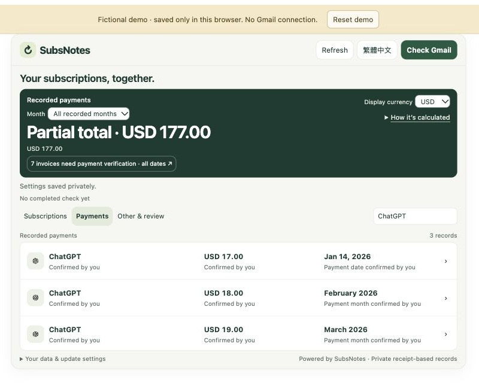
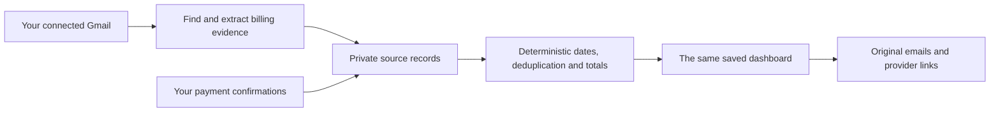

<h1 align="center">SubsNotes</h1>
<p align="center"><strong>Know what you pay. Decide what to keep.</strong><br>A private subscription list with payment history you can check and correct.</p>
<p align="center"><a href="https://christimciel.github.io/SubsNotes/confirmations.html"><strong>Try the fictional demo</strong></a> · <a href="https://github.com/ChristimCiel/SubsNotes/releases/download/v0.2.0-alpha.12/subsnotes-subscription-review.zip"><strong>Download the Claude skill</strong></a> · <a href="README.zh-TW.md">繁體中文</a></p>
<p align="center"><sub>Alpha.12 preview · Main experience: Claude web + Gmail · No SubsNotes desktop app required. <a href="https://github.com/ChristimCiel/SubsNotes/releases/tag/v0.2.0-alpha.12">Release notes and download checksums</a></sub></p>

<p align="center"></p>
<p align="center"><sub>Fictional demonstration data. No personal mail, billing records or credentials are included.</sub></p>

## What you can do

- **Find subscriptions in Gmail.** Review services, recorded prices, renewal notices and original source emails.
- **See recorded spending.** Keep original currencies and inspect payments by month. Annual charges stay whole in their payment month.
- **Confirm what you know.** Record an exact payment date or just a month. User confirmations are labeled separately from email evidence.
- **Keep your corrections.** Reopen the same dashboard and rescan without silently replacing your confirmations.
- **Choose your next step.** Open a provider's management page or leave a review note. Cancellation stays with the provider.
- **Use English or Traditional Chinese.** Switch languages without creating another ledger.

The demo runs on fictional data. It does not connect Gmail, send reminders or cancel subscriptions.

## Choose how to use SubsNotes

| Option | Use it for | Start here |
| --- | --- | --- |
| **Claude web — main experience** | Find subscriptions in Gmail and reopen your saved private dashboard. | [Download the skill](https://github.com/ChristimCiel/SubsNotes/releases/download/v0.2.0-alpha.12/subsnotes-subscription-review.zip) · [Setup guide](guide/en/usage.md) |
| Browser demo | Explore the interface using fictional records, without an account. | [Open the demo](https://christimciel.github.io/SubsNotes/confirmations.html) |
| Local MCP Reader — optional | Let a compatible desktop assistant read a chosen local evidence folder. | [Reader setup](renew-before-service/README.md#ai-reader) |
| macOS app — experimental source | Build a separate native client with a menu bar, hotkey and local reminders. | [Source build and Gmail setup](renew-before-mac/README.md) |

The MCP Reader does not connect Gmail or automatically read the Claude web ledger. The macOS client requires macOS/Xcode and separate configuration; alpha.12 does not include a ready-to-install macOS app. Neither local option is required for the main Claude web experience.

## Start in Claude

**You need:** a Claude account with Gmail, code execution, and native Artifact connectors/personal storage available. Personal Artifact storage requires [an eligible paid Claude plan](https://support.claude.com/en/articles/17153992-what-are-artifacts-and-how-do-i-use-them). SubsNotes itself adds no subscription, model API key, hosting account or separate desktop app.

1. **Install the skill.** [Download `subsnotes-subscription-review.zip` for alpha.12](https://github.com/ChristimCiel/SubsNotes/releases/download/v0.2.0-alpha.12/subsnotes-subscription-review.zip), then upload and enable it in Claude's skill settings. Menu names can vary by account. If the download does not start, open the [alpha.12 release page](https://github.com/ChristimCiel/SubsNotes/releases/tag/v0.2.0-alpha.12) and expand **Assets**.
2. **Connect Gmail in Claude.** Check the account and the requested read-only access. Installing a skill does not grant Gmail access.
3. **Ask Claude:**

   > Use SubsNotes to find my personal subscriptions. Keep the ledger private and show the saved dashboard in English.

Check **Only you** before continuing. Bookmark the resulting private Artifact and reopen that same dashboard next time. A new Artifact has a different store.

**Already have a dashboard?** Open its saved private link. You do not need another installation or a newly generated dashboard. [Full usage guide →](guide/en/usage.md)

## Confirm a payment

Open an invoice or payment record, choose **Confirm payment**, check the amount and currency, then select **Exact date** or **Month only**. Save and wait for confirmation before closing the page.

Month-only confirmation records the month without inventing a day. **Confirmed by you** means a user-reported payment; it does not claim bank reconciliation. You can edit or remove a confirmation while retaining the original evidence. See [payment rules and corrections](guide/en/usage.md#confirm-and-correct-payments).

## How AI fits



Your existing assistant helps find and explain evidence. SubsNotes keeps source history, your confirmations and spending rules together. An AI suggestion cannot declare itself a user confirmation. [How it works →](guide/en/how-it-works.md)

## A few important limits

- Email is dated evidence, not a live provider account or bank feed. Missing mail does not prove cancellation.
- **Refresh** reloads saved records; **Check Gmail** searches for changes. Optional checks run only while the page is open and visible.
- Review dates are notes in the dashboard. They do not send notifications.
- Reference-currency conversion is an estimate; original-currency amounts remain available.
- Keep one editable dashboard open during updates. Host availability and permissions still apply.

## Prefer a local sample?

Requires **Node.js 22+** and npm. No account, API key or cloud database is needed for the fictional sample.

```sh
git clone https://github.com/ChristimCiel/SubsNotes.git
cd SubsNotes
npm ci --prefix renew-before-service
npm run sample
npm start
```

Open http://127.0.0.1:4183/ and stop with Ctrl+C. The sample refuses to overwrite existing data. The local report is read-only. [Other ways to use SubsNotes →](guide/en/how-it-works.md#other-ways-to-use-subsnotes)

## Source layout

**Renew Before** is the earlier project name. SubsNotes retains those source-folder names and existing app/storage identifiers for compatibility.

| Folder | Contents |
| --- | --- |
| [`renew-before-service/`](renew-before-service/) | Shared billing rules, Claude dashboard/skill, local report and MCP Reader. |
| [`renew-before-demo/`](renew-before-demo/) | Browser demo sources and generated demo output. |
| [`renew-before-mac/`](renew-before-mac/) | Optional experimental native macOS client. |
| [`guide/`](guide/) | English and Traditional Chinese usage documentation. |

## Help and community

| I want to… | Read |
| --- | --- |
| Connect, confirm, edit or reopen | [Usage](guide/en/usage.md) |
| Understand the AI and storage boundaries | [How it works](guide/en/how-it-works.md) |
| Fix a blank panel, missing record or failed save | [FAQ & troubleshooting](guide/en/help.md) |
| Choose a download or update safely | [Downloads & updates](guide/en/releases.md) |
| Understand data access and report a vulnerability | [Security & privacy](SECURITY.md) |
| Report a bug or contribute | [Contributing](CONTRIBUTING.md) |

Bug reports and small improvements are welcome. Use fictional examples and synthetic screenshots in public Issues. Never upload private receipts, mailbox exports, account links or credentials.

## License

[MIT](LICENSE). Commercial and noncommercial use are both permitted under its terms. Contributors retain copyright to their work. Dependencies, service marks and artwork retain their own notices; displaying a service does not imply affiliation. [License FAQ](guide/en/help.md#can-subsnotes-be-used-commercially)
