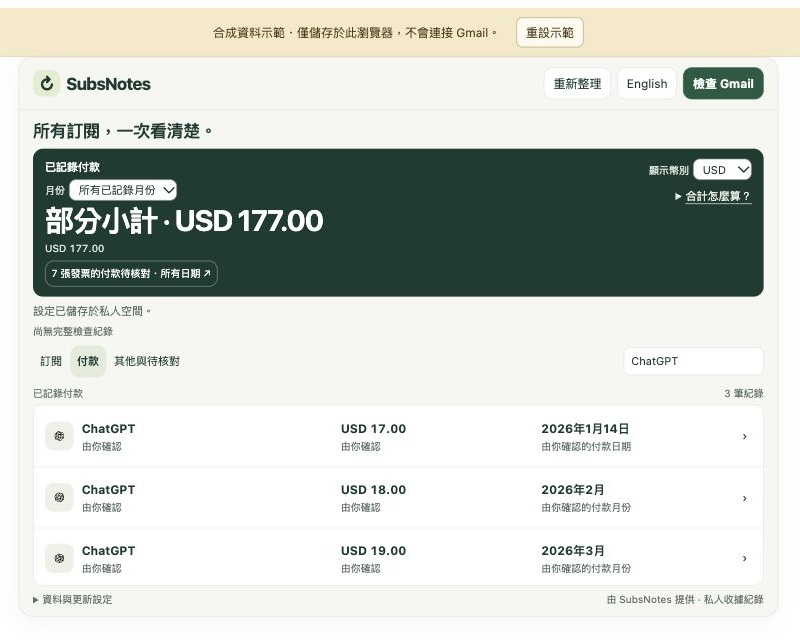
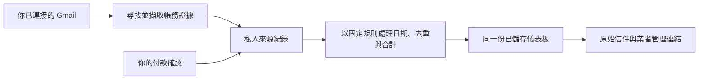

<h1 align="center">SubsNotes</h1>
<p align="center"><strong>看懂訂閱支出，自己決定哪些要保留。</strong><br>一份私人訂閱清單，付款紀錄可查來源，也能自行確認與更正。</p>
<p align="center"><a href="https://christimciel.github.io/SubsNotes/confirmations.html"><strong>試用合成資料示範</strong></a> · <a href="https://github.com/ChristimCiel/SubsNotes/releases/download/v0.2.0-alpha.12/subsnotes-subscription-review.zip"><strong>下載 Claude 技能</strong></a> · <a href="README.md">English</a></p>
<p align="center"><sub>Alpha.12 預覽版・主要使用方式：Claude 網頁版＋Gmail・不需安裝 SubsNotes 桌面 App。<a href="https://github.com/ChristimCiel/SubsNotes/releases/tag/v0.2.0-alpha.12">版本說明與下載校驗碼</a></sub></p>

<p align="center"></p>
<p align="center"><sub>畫面全為合成示範資料，不含個人郵件、真實帳單或憑證。</sub></p>

## 可以做什麼

- **從 Gmail 找訂閱。** 查看服務、記錄價格、續訂通知與原始信件。
- **看懂已記錄支出。** 保留原始幣別，按月份查看付款；年費全額計入付款月份。
- **確認自己知道的資料。** 可以填精確付款日期，也可以只確認月份；本人確認與郵件證據分開標示。
- **保留更正。** 重開原本的儀表板或再次掃描，不會默默取代你的確認。
- **完成下一步。** 開啟業者管理頁面，或留下一個再看日期；取消訂閱仍由你在業者端完成。
- **切換英文與繁體中文。** 換語言不會建立另一份帳本。

公開示範只使用合成資料，不會連接 Gmail、發出提醒或取消訂閱。

## 選擇使用方式

| 方式 | 用途 | 從這裡開始 |
| --- | --- | --- |
| **Claude 網頁版・主要體驗** | 從 Gmail 找訂閱，重開已儲存的私人儀表板。 | [下載技能](https://github.com/ChristimCiel/SubsNotes/releases/download/v0.2.0-alpha.12/subsnotes-subscription-review.zip)・[設定指南](guide/zh-TW/usage.md) |
| 瀏覽器示範 | 不需帳號，以合成紀錄探索介面。 | [開啟示範](https://christimciel.github.io/SubsNotes/confirmations.html) |
| 本機 MCP Reader・選用 | 讓相容的桌面助理唯讀存取你選定的本機帳務資料夾。 | [Reader 設定](renew-before-service/README.md#ai-reader) |
| macOS App・實驗性原始碼 | 自行建置獨立的原生客戶端，使用選單列、快捷鍵與本機提醒。 | [原始碼建置與 Gmail 設定](renew-before-mac/README.md) |

MCP Reader 不會連接 Gmail，也不會自動讀取 Claude 網頁帳本。macOS 客戶端需要 macOS／Xcode 及獨立設定；alpha.12 未附可直接安裝的 macOS App。主要的 Claude 網頁體驗不需要這兩個本機元件。

## 在 Claude 開始使用

**需要的條件：**Claude 帳號必須有可用的 Gmail、程式執行，以及原生 Artifact 連接器與個人儲存空間。個人 Artifact 儲存需[符合資格的付費 Claude 方案](https://support.claude.com/en/articles/17153992-what-are-artifacts-and-how-do-i-use-them)。SubsNotes 本身不另收訂閱費，也不要求模型 API key、託管帳號或獨立桌面 App。

1. **安裝技能。** [直接下載 alpha.12 的 `subsnotes-subscription-review.zip`](https://github.com/ChristimCiel/SubsNotes/releases/download/v0.2.0-alpha.12/subsnotes-subscription-review.zip)，在 Claude 的技能設定上傳並啟用。選單名稱可能因帳號而異。若未開始下載，開啟 [alpha.12 版本頁](https://github.com/ChristimCiel/SubsNotes/releases/tag/v0.2.0-alpha.12)，展開 **Assets**。
2. **在 Claude 連接 Gmail。** 核對帳號與唯讀權限；安裝技能本身不會授予信箱權限。
3. **對 Claude 說：**

   > 使用 SubsNotes 整理我的個人訂閱，將帳本保存在私人空間，並以繁體中文開啟已儲存的儀表板。

繼續前確認分享狀態是 **Only you／只有你**。將產生的私人 Artifact 加入書籤，下次重開同一份儀表板；新 Artifact 會有另一個儲存空間。

**已經有儀表板？** 直接開啟原本的私人連結，不需重新安裝，也不需重新生成。［[完整使用指南](guide/zh-TW/usage.md)］

## 確認一筆付款

開啟發票或付款紀錄，選「**確認付款**」，核對金額與幣別，再選「**精確日期**」或「**只確認月份**」。儲存後等成功訊息出現，再關閉頁面。

只確認月份時不會補上一個虛構日期。「**由你確認**」代表本人回報，不等於已與銀行對帳。你可以編輯或撤回確認，原始證據仍會保留。詳見[付款規則與更正](guide/zh-TW/usage.md#確認與更正付款)。

## AI 負責哪一段



你既有的 AI 助理協助找資料、解釋差異；SubsNotes 將來源歷史、本人確認與支出規則放在同一份帳本中。AI 提案不能自行宣稱是你已確認的資料。［[運作方式](guide/zh-TW/how-it-works.md)］

## 先知道這幾項限制

- 郵件是有日期的證據，不是業者即時帳戶或銀行資料串流；缺少郵件不代表已取消。
- 「**重新整理**」讀取已儲存資料；「**檢查 Gmail**」搜尋變更。選用自動檢查只在頁面開啟且位於前景時執行。
- 再看日期只是儀表板內的紀錄，不會發送通知。
- 換算幣別金額是參考估算，原始幣別會保留。
- 更新時同一時間只開啟一個可編輯儀表板；仍受 AI 平台可用性與權限影響。

## 想先在本機試用？

需要 **Node.js 22+** 與 npm。合成範例不需帳號、API key 或雲端資料庫。

```sh
git clone https://github.com/ChristimCiel/SubsNotes.git
cd SubsNotes
npm ci --prefix renew-before-service
npm run sample
npm start
```

開啟 http://127.0.0.1:4183/，以 Ctrl+C 停止。範例不會覆寫既有資料；本機報告是唯讀。［[其他使用方式](guide/zh-TW/how-it-works.md#其他使用方式)］

## 原始碼目錄

**Renew Before** 是專案早期名稱。SubsNotes 為了相容既有使用方式，保留這些原始碼資料夾名稱及原有 App／儲存識別碼。

| 資料夾 | 內容 |
| --- | --- |
| [`renew-before-service/`](renew-before-service/) | 共用帳務規則、Claude 儀表板／技能、本機報告與 MCP Reader。 |
| [`renew-before-demo/`](renew-before-demo/) | 瀏覽器示範原始碼與產出的示範檔案。 |
| [`renew-before-mac/`](renew-before-mac/) | 選用的實驗性原生 macOS 客戶端。 |
| [`guide/`](guide/) | 英文與繁體中文使用文件。 |

## 說明與社群

| 我想要… | 閱讀 |
| --- | --- |
| 連接、確認、更正或重開 | [使用指南](guide/zh-TW/usage.md) |
| 了解 AI 與儲存界線 | [運作方式](guide/zh-TW/how-it-works.md) |
| 排除空白面板、缺少紀錄或儲存失敗 | [常見問題與疑難排解](guide/zh-TW/help.md) |
| 選擇下載檔或安全更新 | [下載與更新](guide/zh-TW/releases.md) |
| 了解資料存取與通報安全問題 | [安全與隱私](SECURITY.zh-TW.md) |
| 回報問題或貢獻 | [參與貢獻](CONTRIBUTING.zh-TW.md) |

歡迎回報問題與小幅改善。公開 Issue 請使用合成範例與截圖，勿附私人收據、信箱匯出、帳戶連結或憑證。

## 授權

[MIT](LICENSE)。依條款可作商業與非商業使用。貢獻者保留其作品著作權；相依套件、服務商標與圖像另有各自聲明。展示服務不代表合作或背書。［[授權常見問題](guide/zh-TW/help.md#subsnotes-可以商業使用嗎)］
