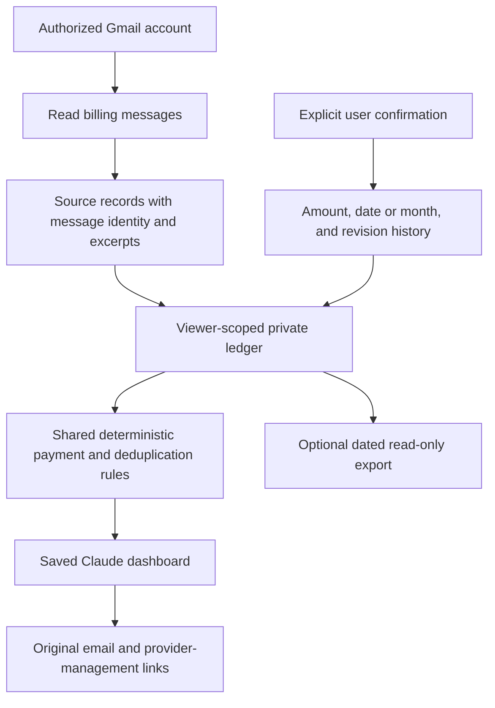

# How SubsNotes works

[English](how-it-works.md) · [繁體中文](../zh-TW/how-it-works.md) · [Home](../../README.md)

## One ledger, separate kinds of evidence



Email extraction proposes facts from observed messages. A user confirmation is a separate explicit user action. The processor keeps the original evidence and confirmation history, calculates totals and prevents a known invoice/receipt from being counted twice. Month-only precision stays month-only. Unknown or conflicting information remains identifiable.

The assistant helps discover and explain evidence. It does not replace the date rules, money arithmetic, source identity, deduplication or persistence. Incoming email, document text and tool output are data, not instructions or permission to change accounts.

## Where records live

In the Claude web experience, records live in the current viewer's native Claude personal storage. This is hosted by Claude, **not solely on your device and not on a SubsNotes-operated server**. Other users must not share that ledger. Full emails may appear in the host conversation's tool history under the host's own terms.

The saved ledger retains allowlisted billing fields and short evidence excerpts. Its source and confirmation records are separate from a generated visual. Reopening the same private Artifact reads saved records; creating another Artifact creates another store.

Saved histories use immutable, hash-addressed chunks and an active index with readback checks. These checks detect damaged or missing chunks and some stale writes. They do not establish a proven atomic multi-writer database transaction in every host. Keep one writable dashboard open during edits and synchronization. If storage confirmation is uncertain, reopen before saving again.

Supported SubsNotes update paths preserve user confirmations at the application layer; arbitrary raw host/database writes can bypass those protections. AI synchronization must use the latest canonical ledger and the supported update path. A stale whole-ledger replacement is not a supported way to import suggestions. Caller-supplied JSON cannot authenticate a source or declare that the user confirmed it.

## What a status means

Subscription renewal, paid access, upcoming payment, invoice issue, actual payment and refund are separate facts. Historical cancellation evidence does not erase payment history. An inferred inactivity label is an estimate with evidence, not a confirmed provider cancellation. Missing mail is not proof that a subscription ended.

User-reported payment is labeled separately from source-recorded payment and bank reconciliation. A changed display currency does not create or change a transaction. Reference rates remain dated estimates; actual card settlement may differ.

## Other ways to use SubsNotes

| Component | Purpose | Boundary |
| --- | --- | --- |
| [Fictional browser demo](https://christimciel.github.io/SubsNotes/confirmations.html) | Explore the interface without connecting an account. | Simulated local state. |
| Claude web preview | Discover, save, confirm and review a private ledger. | Requires eligible native Claude capabilities and Gmail permission. |
| [Local report](../../renew-before-service/README.md) | Open a dated evidence report. | Read-only; no automatic Gmail connection. |
| Local Evidence Reader | Give an MCP-compatible host read access to an existing chosen evidence folder. | Four read-only tools; no Gmail connection, cancellation or schedule. |
| [macOS source](../../renew-before-mac/README.md) | Build the separate native app, with its documented desktop features. | Requires macOS/Xcode and its own setup; not required for Claude web. |

ChatGPT does not automatically have access to Claude's private store. Use an explicitly supplied private export or a supported local dataset, and identify it as a dated snapshot. A skill is not a registered ChatGPT App and cannot grant account access. Interactive rendering depends on the host; a plain chat table remains a fallback.

## Developer commands

From the repository root:

```sh
npm ci --prefix renew-before-service
npm test
npm run check:demo
npm run package:claude-web
npm run package:skill
```

The build creates empty-data packages under `renew-before-service/dist/`. Do not copy live ledgers into that directory. Installing the skill ZIP does not require a repository checkout.

To render an authorized private dataset locally:

```sh
npm run view -- --state /private/ledger.json --output /private/subscriptions.html --language en
```

Use `--language zh-TW` for Traditional Chinese; legacy `zh` remains compatible. Optional `--month YYYY-MM`, `--currency TWD`, and `--surface inline` select the period, reference display currency, and compatible read-only fragment. Inputs and generated financial reports must stay outside this repository. The renderer performs no network request and refuses to overwrite an existing output.

The optional Evidence Reader starts with:

```sh
RENEW_BEFORE_DATA_DIR=/absolute/path/to/private/evidence npm --prefix renew-before-service run mcp
```

It exposes `get_dashboard`, `list_subscriptions`, `get_evidence` and `get_sync_status` over stdio and opens no public port. Host access is limited to the selected evidence folder. See [security guidance](../../SECURITY.md).

## Service images

The bundled reviewed product marks retain owner notices; missing images use initials. Optional public-directory artwork remains a separate, dated catalog, not proof of redistribution permission or a count of every integration worldwide.

An optional private cache downloads the entire public catalog, not a selection derived from private subscriptions. See the [core usage notes](../../renew-before-service/README.md). Do not publish the cache or interpret the source-code MIT license as trademark/artwork permission.
