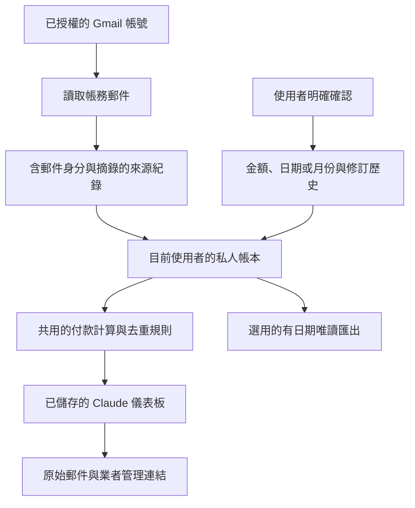

# SubsNotes 如何運作

[English](../en/how-it-works.md) · [繁體中文](how-it-works.md) · [首頁](../../README.zh-TW.md)

## 同一份帳本，分開保存各種證據



郵件擷取會從實際讀取的信件提出欄位；本人確認則是另外一次明確操作。資料處理器保留原始證據及確認歷史，以固定規則計算合計，避免已知的同一張發票／收據重複計入。只知道月份，就保留月份精確度；未知或矛盾的資訊仍可辨識。

AI 助理協助找資料、解釋差異，不取代日期規則、金額計算、來源身分、去重及持久儲存。郵件、文件與工具回傳都是資料，不是操作指令或變更帳戶的授權。

## 資料存在哪裡

Claude 網頁版將紀錄存入目前使用者的 Claude 原生個人儲存空間。資料由 Claude 託管，**不是只留在你的裝置，也不是存在 SubsNotes 經營的伺服器**。不同使用者不應共用帳本。完整郵件也可能出現在 AI 平台的對話工具歷史，受平台本身條款管理。

儲存帳本保留允許的帳務欄位及必要短摘錄；來源與本人確認不等於產生的視覺畫面。重開相同的私人 Artifact 會讀取既有紀錄；建立另一個 Artifact 會產生另一個儲存空間。

歷史紀錄使用不可變、更動可由雜湊辨識的資料區塊，再由有效索引指向目前版本，並進行讀回確認。這能發現損壞、缺少區塊及部分舊版本寫入，但不代表每個平台都有經證實的原子多寫入交易。編輯或同步時只開一個可寫入儀表板；若儲存確認不明，先重開再寫入。

受支援的 SubsNotes 更新路徑會在應用程式層保留本人確認；任意直接寫入平台／資料庫仍可能繞過此保護。AI 同步須使用最新的權威帳本及既有更新路徑，不支援直接拿過期的整份帳本取代目前資料。呼叫端自行提供的 JSON，不能驗證來源，也不能自行宣稱使用者已確認。

## 狀態代表什麼

是否續訂、已付使用期間、下次付款、發票開立、實際付款及退款，是不同事實。歷史取消證據不會抹除付款紀錄。推估不活躍狀態是附來源的估計，不是業者已確認取消；缺少郵件也不能證明訂閱終止。

本人回報付款、來源記錄付款及銀行對帳分開標示。換顯示幣別不會建立或更改交易。參考匯率有各自日期，實際信用卡入帳可能不同。

## 其他使用方式

| 元件 | 用途 | 界線 |
| --- | --- | --- |
| [合成資料示範](https://christimciel.github.io/SubsNotes/confirmations.html) | 不連接帳號即可探索介面。 | 模擬的本機狀態。 |
| Claude 網頁預覽 | 尋找、儲存、確認與檢視私人帳本。 | 需具備相容的 Claude 原生能力與 Gmail 授權。 |
| [本機報告](../../renew-before-service/README.md) | 開啟有日期的帳務證據報告。 | 唯讀，不會自動連接 Gmail。 |
| 本機 Evidence Reader | 讓相容 MCP 助理讀取你指定的既有帳務資料夾。 | 只有四個唯讀工具，不會連信箱、取消訂閱或建立排程。 |
| [macOS 原始碼](../../renew-before-mac/README.md) | 自行編譯原生 App，使用其文件記載的桌面功能。 | 需 macOS／Xcode 與獨立設定；Claude 網頁不需安裝它。 |

ChatGPT 不會自動取得 Claude 私人帳本。可明確提供私人匯出或相容的本機資料，並標示為有日期的快照。技能不是已註冊的 ChatGPT App，也不能自行取得帳號權限。互動畫面取決於平台是否支援；純文字表格仍是替代方式。

## 開發者指令

在 repository 根目錄執行：

```sh
npm ci --prefix renew-before-service
npm test
npm run check:demo
npm run package:claude-web
npm run package:skill
```

產物位於 `renew-before-service/dist/`，套件不含使用者資料，勿將真實帳本放進該目錄。單純安裝技能 ZIP 不需 clone repository。

在本機產生已授權私人資料的唯讀畫面：

```sh
npm run view -- --state /private/ledger.json --output /private/subscriptions.html --language zh-TW
```

英文使用 `--language en`，舊的 `zh` 仍相容。可加 `--month YYYY-MM`、`--currency TWD`、`--surface inline` 指定期間、參考顯示幣別與相容唯讀片段。輸入與產生的財務報告都必須放在 repository 以外；產生器不發網路請求，也不覆寫既有輸出。

選用的 Evidence Reader 啟動方式：

```sh
RENEW_BEFORE_DATA_DIR=/absolute/path/to/private/evidence npm --prefix renew-before-service run mcp
```

它以 stdio 提供 `get_dashboard`、`list_subscriptions`、`get_evidence`、`get_sync_status`，不開啟公開連接埠。助理只取得指定帳務資料夾的存取權。詳見[安全說明](../../SECURITY.zh-TW.md)。

## 服務圖像

隨套件提供的已審閱產品標誌保留各自聲明；缺少圖像時使用縮寫。另有較廣的公開目錄快照，但不是圖像重散布權的證明，也不是全球所有整合的數量。

選用的私人快取會下載整份公開目錄，而不是根據你的訂閱選擇性查詢。詳見[核心使用說明](../../renew-before-service/README.md)。不要公開快取，也不要將程式碼 MIT 授權當成商標／圖像授權。
